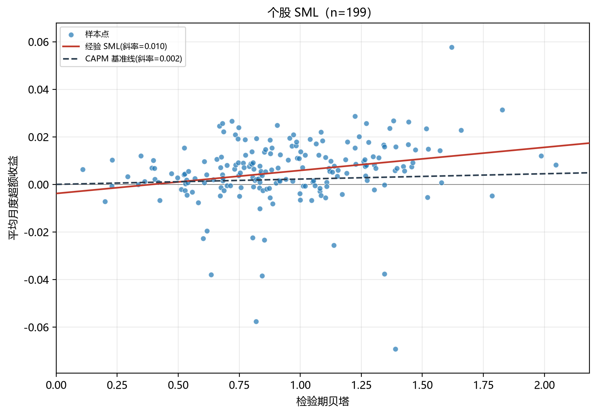
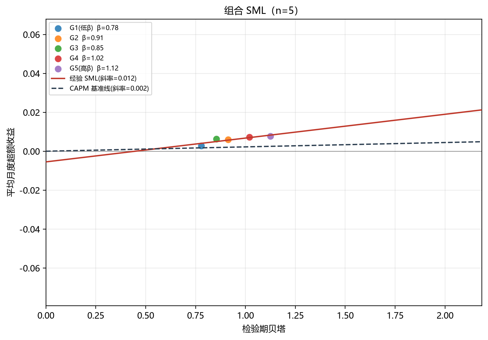
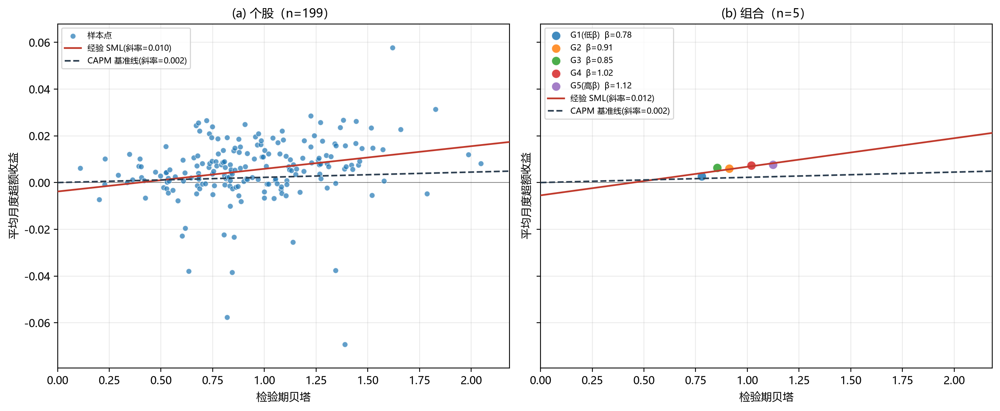
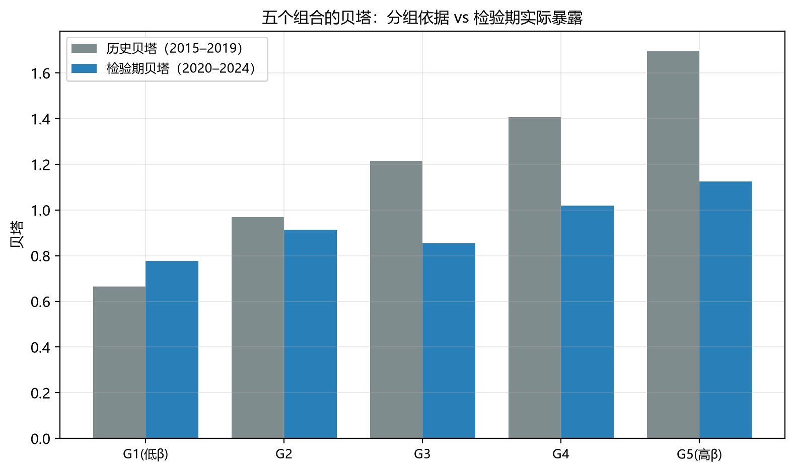
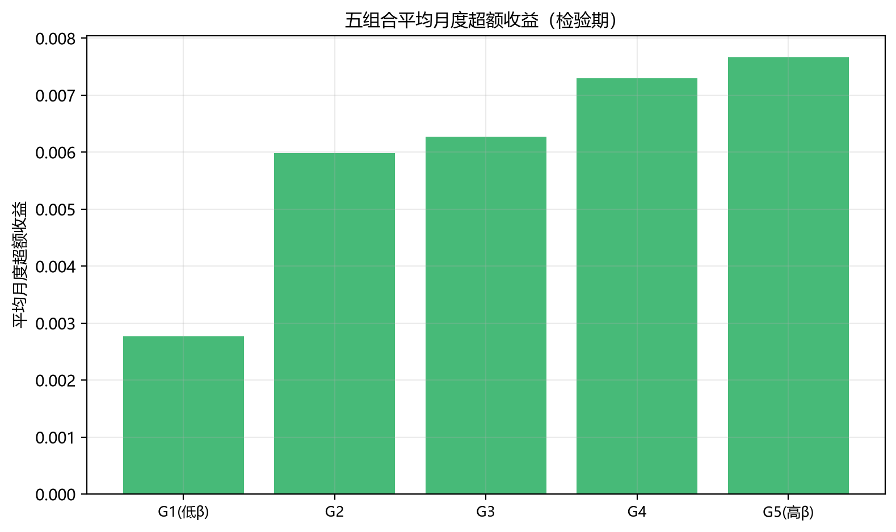

# 高贝塔股票是否获得更高收益？

## ——基于个股与投资组合的 CAPM 模型实证分析

> 投资学第二次团队作业
> 组员：________（学号 ________）、________（学号 ________）、________（学号 ________）、________（学号 ________）、________（学号 ________）

---

## 摘要

本文用 2015–2019 年数据估计 A 股 200 只股票的月度贝塔，按贝塔从低到高分为五组，检验 2020–2024 年贝塔与平均超额收益的关系，并比较个股与组合两种视角下的证券市场线（SML）。

样本证据显示：**平均超额收益随历史贝塔单调上升**（0.28% → 0.77%/月），最高与最低组差 **0.49%/月（年化 6.04%）**，方向与 CAPM 一致；但 t 值仅 0.82，三种 95% 置信区间均包含 0，幅度上无法与零区分。**贝塔排序部分保持**：Spearman ρ = 0.32，检验期 β 对历史 β 的回归斜率仅 0.32，组间贝塔差距从 1.03 压缩到 0.35。**组合显著改善了风险—收益关系的清晰度**（R² 从 0.061 升至 0.743，残差标准差降为 1/14），但组合 SML 的斜率（0.0122）是 CAPM 基准线（0.0022）的 5.6 倍、截距为负——组合不是更贴近基准线，而是更清楚地暴露了偏离。

综合判断：本样本在**方向上**支持 CAPM，在**幅度上**无法确认，更不能据此「验证」模型。

---

## 一、研究问题

CAPM 预测平均超额收益与贝塔成正比：截距为零、斜率为市场平均超额收益。本文检验三点：

1. **横截面关系**：平均超额收益是否随贝塔上升？高低组差多少？
2. **组合视角**：分散化是否让这一关系更清晰？
3. **证据强度**：样本在多大程度上支持该关系？

需要强调：本作业评价的是**样本证据对 CAPM 的支持程度**，不是证明模型成立。

---

## 二、数据与样本

### 2.1 数据来源

| 变量 | 来源 | 口径 |
|---|---|---|
| 股票名单 | 上交所 / 深交所官方接口 | 冻结于 2019-12-31，含此后退市股票 |
| 行业分类 | 证监会行业分类（大类） | 用于行业分层抽样 |
| 个股收益 | 腾讯财经月度行情（后复权） | 含分红再投资 |
| 市场收益 | 中证指数官网 H00985 | 中证全指**全收益**指数 |
| 无风险利率 | 中债国债收益率曲线 1 年期 | 月度 = (1+y)^{1/12}−1 |

所有序列统一为月度频率。市场基准剔除无风险利率后，检验期平均月度超额收益为 **0.22%**（年化 2.72%）。

### 2.2 样本构造

- 股票池 **3775 只**（2019-12-31 已上市、当日仍存续），其中 **237 只在此后退市**，全部保留在池内，避免幸存者偏差；
- 按证监会行业大类分层随机抽取：基础池 260 只（目标 200 × 1.3）+ 追加池 40 只，随机种子 20261023；
- 要求估计期内每只股票至少 **48 个有效配对月份**，300 只候选中剔除 88 只（29%）；
- 合格 212 只，按行业配额随机抽取 **200 只**，覆盖 **54 个行业大类**，其中退市股 15 只；五个组合各 40 只。

### 2.3 处理规则

| 情形 | 处理 |
|---|---|
| 整月停牌 | 价格未变，收益记 0 并单独打标（经济真实值，不是用 0 填补缺失）；全样本 476 个停牌月，占 1.97% |
| 退市 | 退市当月仍计入，此后自然退出组合，不做事后剔除 |
| 数据缺失 | 不填 0；组合当月只用可得成员求均值（等价于恢复等权） |
| 异常值 | 不做人工剔除；价格异常（< 0.01 元）视为缺失 |

### 2.4 可能的选择偏差

样本为「2019 年末存续 + 之后退市」的股票，已消除退市带来的幸存者偏差，但仍存在两点保留意见：一是行业分层只按数量比例分配名额，未按市值加权，样本偏中小盘；二是要求 2015–2019 至少 48 个月数据，隐含排除了 2016 年后上市的次新股。

---

## 三、方法

$$r^e_{i,t}=\alpha_i+\beta_i R^e_{m,t}+\varepsilon_{i,t},\qquad r^e_{i,t}=r_{i,t}-r_{f,t},\quad R^e_{m,t}=R_{m,t}-r_{f,t}$$

1. **估计期（2015–2019）**：逐只 OLS 得历史贝塔，标准误用 Newey–West（滞后 6 期）；
2. **分组**：按 $\hat\beta_i$ **数值**升序等分五组，等权，检验期内不重新分组，每月恢复等权；
3. **检验期（2020–2024）**：重新估计组合与个股的贝塔、阿尔法；计算最高−最低组逐月收益差及置信区间；
4. **SML**：横轴检验期贝塔、纵轴平均月度超额收益，叠加经验拟合线与 CAPM 基准线（截距 0、斜率 = 0.22%）。

### 3.1 定义法与 OLS 为何必然一致

含截距 OLS 的正规方程给出

$$\hat\beta=\frac{\sum_t(R^e_{m,t}-\bar R^e_m)(r^e_{i,t}-\bar r^e_i)}{\sum_t(R^e_{m,t}-\bar R^e_m)^2}$$

而样本协方差与样本方差（同为 $n-1$ 分母）之比为

$$\frac{\widehat{\mathrm{Cov}}(r^e_i,R^e_m)}{\widehat{\mathrm{Var}}(R^e_m)}
=\frac{\frac{1}{n-1}\sum_t(r^e_{i,t}-\bar r^e_i)(R^e_{m,t}-\bar R^e_m)}{\frac{1}{n-1}\sum_t(R^e_{m,t}-\bar R^e_m)^2}$$

$n-1$ 相消后两式恒等。一致性成立的前提是：**同一样本、同一组配对观测（缺失成对剔除）、回归含截距**。若不设截距，斜率变为 $\sum r^e_iR^e_m/\sum(R^e_m)^2$，不再相等。程序对全部 200 只股票逐一比对，最大绝对差 **4.4×10⁻¹⁶**，仅为浮点误差。

---

## 四、估计期贝塔

估计期贝塔均值 **1.191**、中位数 **1.235**，区间 [0.33, 2.25]，分布略左偏（低贝塔股票较少），与 A 股整体波动高于市场组合的事实一致。

### 表 2 三只股票的贝塔计算核对

| 分层 | 代码 | 简称 | 行业 | 月份数 | cov | var | 定义法 β | OLS β | 绝对差 |
|---|---|---|---|---|---|---|---|---|---|
| 低贝塔 | 300101 | 振芯科技 | I65 软件和信息技术服务业 | 60 | 0.004975 | 0.005700 | 0.872842 | 0.872842 | 0.0 |
| 中贝塔 | 000697 | 炼石航空 | C37 铁路、船舶、航空航天和其他运输设备制造业 | 60 | 0.007047 | 0.005700 | 1.236320 | 1.236320 | 0.0 |
| 高贝塔 | 603939 | 益丰药房 | F52 零售业 | 58 | 0.008841 | 0.005846 | 1.512229 | 1.512229 | 4.4e-16 |

> 表注：三只股票分别位于贝塔分布的 20%、50%、80% 分位附近。注意第三行只有 58 个月（估计期内有停牌），因此其市场方差为 0.005846 而非 0.005700——**定义法必须与 OLS 使用同一组配对观测**，否则两者不再相等。这正是「同一样本」这一前提的具体体现。

---

## 五、五个组合的检验期表现

### 表 3 五组合对比

| 组合 | 平均只数 | 历史 β | 检验期 β | β 标准误 | 平均月超额收益 | α(月度) | α 标准误 | α 的 p 值 | R² |
|---|---|---|---|---|---|---|---|---|---|
| G1(低β) | 39 | 0.665 | 0.778 | 0.050 | 0.277% | 0.103% | 0.277% | 0.710 | 0.717 |
| G2 | 38 | 0.968 | 0.913 | 0.045 | 0.599% | 0.395% | 0.338% | 0.244 | 0.742 |
| G3 | 40 | 1.215 | 0.855 | 0.042 | 0.627% | 0.436% | 0.359% | 0.225 | 0.688 |
| G4 | 38 | 1.407 | 1.019 | 0.068 | 0.730% | 0.502% | 0.383% | 0.190 | 0.705 |
| G5(高β) | 40 | 1.699 | 1.124 | 0.083 | 0.766% | 0.515% | 0.599% | 0.390 | 0.664 |

三个现象值得注意：

1. **平均超额收益随历史贝塔严格单调上升**（0.277% → 0.766%），方向与 CAPM 一致；
2. **检验期贝塔也大体上升，但差距被压缩**：从 0.778 到 1.124，跨度仅 0.35（历史跨度 1.03）；
3. **五组 α 全部为正**（0.10%–0.52%/月），但都不显著（p 值 0.19–0.71）。α 同号为正，提示还有共同因子未被市场基准吸收（如规模、价值），也可能与样本偏中小盘有关。

### 表 4 最高与最低历史贝塔组合的收益差

| 指标 | 数值 |
|---|---|
| 月度收益差均值 | 0.490% |
| 对应年化 | 6.04% |
| t 统计量 | 0.82 |
| 95% CI（t 分布） | [−0.703%, 1.682%] |
| 95% CI（Newey–West） | [−0.730%, 1.709%] |
| 95% CI（分块自助法，block=3） | [−0.742%, 1.780%] |
| 结论 | 区间包含 0，不能拒绝「收益差为零」 |

**置信区间的计算方法与假设**：

- *t 分布区间*：$\bar d\pm t_{0.975,59}\cdot s_d/\sqrt{60}$（$s_d$ = 4.62%），假设 $d_t$ 近似独立同分布且近似正态；
- *Newey–West 区间*：允许异方差与 6 阶以内自相关，适合月度收益的波动率聚集；
- *分块自助法*：块长 3、重抽 5000 次，保留短期序列相关，不依赖分布假设。

三种区间几乎重合，说明「不显著」不是区间构造方式造成的，而是样本本身的信息量不足。

> 注意：$d_t$ 中两组贝塔相减，市场共同冲击大部分抵消，因此该差值检验的是**贝塔价差是否被定价**，而非市场择时能力。也正因如此，它的标准差（4.62%）远小于任一组收益本身的标准差。

---

## 六、个股与组合的证券市场线

### 表 6 个股与组合的经验 SML 对比

| 口径 | 观察点 | 截距 | 斜率 | 斜率标准误 | R² | 残差标准差 |
|---|---|---|---|---|---|---|
| 个股 | 199 | −0.0038 | 0.0097 | 0.0033 | 0.061 | 0.0136 |
| 组合 | 5 | −0.0055 | 0.0122 | 0.0045 | 0.743 | 0.00098 |

三个对比：

1. **散点分散程度**：组合残差标准差 0.098%，仅为个股 1.36% 的 **1/14**——分散化把公司特有冲击平均掉了；
2. **拟合程度**：组合 R² = 0.743，个股仅 0.061。组合的风险—收益关系确实清晰得多；
3. **与 CAPM 基准线的偏离**：两条经验线的斜率（0.0097、0.0122）都远高于基准线 0.0022，组合线甚至是基准的 **5.6 倍**；两条线的截距都为负。

也就是说，**组合让关系更清晰，但清晰之后看到的是更大的偏离，而不是更贴近 CAPM**。这是本次结果中最值得写进结论的一点。

---

## 七、必答问题

### 问题 1：平均超额收益是否随检验期贝塔上升？高低组差多少？

**是，单调上升**。五组平均月超额收益为 0.277%、0.599%、0.627%、0.730%、0.766%，随历史贝塔递增；按检验期贝塔排序（0.778 < 0.855 < 0.913 < 1.019 < 1.124）也基本对应。

高低组差为 **0.490%/月（年化 6.04%）**，方向与 CAPM 一致；但 t 值仅 **0.82**，95% 置信区间 [−0.70%, 1.68%] 包含 0。因此：

- 点估计支持「高贝塔获得更高收益」；
- 但 60 个月的样本不足以把这个差距与「运气」区分开；
- 区间宽度（±1.2%/月）已覆盖 A 股风险溢价的历史量级，说明这是**信息量不足**，不是方法错误。

### 问题 2：分组后贝塔排序是否保持？若变化如何影响解释？

**方向保持，幅度大幅收缩**：

- 历史 β 从 0.665 升到 1.699（跨度 1.03），检验期 β 从 0.778 升到 1.124（跨度 0.35），**只剩约 1/3**；
- Spearman ρ = **0.324**，检验期 β 对历史 β 的回归斜率 **0.315**、截距 0.559、R² 0.110；
- 不是严格单调：G3 的检验期 β（0.855）低于 G2（0.913）。

**对解释的影响**：

1. 收益差仍然同向，说明排序信息没有完全丢失，但「高贝塔组合」在检验期实际只承担了比「低贝塔组合」高 0.35 的市场风险；
2. 按 CAPM，这 0.35 的贝塔差只应带来 0.35 × 0.22% ≈ **0.08%/月**的收益差，而实际观察到 0.49%/月——**实际差是 CAPM 预测的 6 倍**；
3. 这意味着收益差中只有很小一部分能被「承担市场风险」解释，其余更可能来自分组时与贝塔相关的其他特征（行业、规模、估值风格）。

贝塔收缩本身可预期：估计误差导致极端值向均值回归（Blume 效应），加上 2015 年股灾期间的高贝塔股票在 2020–2024 年波动率相对下降。

### 问题 3：个股与组合的 SML 有何差异？组合是否让关系更清晰？

| 维度 | 个股 | 组合 | 结论 |
|---|---|---|---|
| 散点分散程度 | 残差标准差 1.36% | 0.098% | 组合约为个股的 1/14 |
| 贝塔估计精度 | β 标准误中位数 0.209 | 0.042–0.083 | 组合估计更稳 |
| 拟合程度 | R² 0.061 | R² 0.743 | 组合关系更清晰 |
| 斜率 | 0.0097 | 0.0122 | 组合更陡 |

**组合确实让风险—收益关系更清晰**，机制有三：

1. **分散化消除公司特有噪声**：单只股票的平均超额收益含大量特质波动，组合把它平均掉，散点因此收拢；
2. **贝塔估计更精确**：组合 β 的标准误（0.042–0.083）比个股中位数（0.209）小 2.5–5 倍，横轴「更准」，斜率估计的衰减偏误（attenuation bias）也随之减小；
3. **信噪比提高**：组合的 R² 0.743 意味着贝塔能解释组合收益横截面差异的 74%，而个股只有 6%。

但要注意「更清晰」不等于「更接近 CAPM」——见问题 4。

### 问题 4：组合更接近基准线，能否认为 CAPM 得到更强支持？

**本例中组合并没有更接近基准线，反而更清楚地显示了偏离**，因此不能据此认为 CAPM 得到更强支持：

1. **组合线比基准线陡 5.6 倍**（0.0122 vs 0.0022）。如果 CAPM 成立，两者应重合；现在组合把「高贝塔赚得太多、低贝塔赚得太少」这一偏离放大了，而不是消除；
2. **截距为负**（−0.55%/月）。CAPM 要求截距为零；负截距配合陡斜率意味着低贝塔组的收益低于无风险利率之上的应有水平；
3. **只有 5 个观察点**。用 5 点拟合 2 个参数，R² 天然容易高（这里 0.743），但它衡量的是「5 个点是否接近一条直线」，不是「这条线是否等于 CAPM 基准线」；
4. **组内正负 α 可能抵消**：若组内有个股 α 一正一负，组合 α 会被平均掉，看起来「误差更小」，但这只是算术结果。

换句话说：**组合改善的是估计精度（问题 3），不是模型拟合优度（问题 4）**。要判断 CAPM 是否成立，需要看经验线是否与基准线重合（斜率和截距的联合检验），而不是看 R²。

### 问题 5：高贝塔组合没有更高收益，能否否定 CAPM？

**这个前提在本样本中不成立**：高贝塔组（G5）月均超额收益 0.766%，确实高于低贝塔组（G1）的 0.277%，差 0.49%/月。所以不是「没有更高收益」，而是「更高，但不确定」。

即使假设高贝塔组没有更高收益，也不能否定 CAPM，理由有四点：

1. **实际贝塔差距很小**：G5 与 G1 的检验期 β 只差 0.35，CAPM 预测的收益差仅 0.08%/月，本来就难以观测；
2. **市场风险溢价本身很小**：检验期市场平均超额收益仅 0.22%/月，CAPM 的整个斜率都很平；
3. **CAPM 说的是期望收益**，60 个月的样本均值标准误约 1%/月，与待检验效应同阶；
4. **本次点估计方向是对的**（+0.49%/月），只是不显著。真正的证据是「无法拒绝」，不是「拒绝」。

### 问题 6：本样本在多大程度上支持 CAPM？

必须区分三种判断：

| 判断 | 本次结果 | 说明 |
|---|---|---|
| 贝塔排序保持 | **部分保持** | ρ = 0.32，方向对但幅度收缩到 1/3 |
| 样本收益符合预测 | **方向符合、幅度不符** | 单调上升，但差值是 CAPM 预测的 6 倍且不显著 |
| 模型得到验证 | **不能** | 单一样本、单一期间、市场组合不可观测 |

一个有意思的组合结论：收益**排序**符合 CAPM，收益**幅度**偏离 CAPM，而**组合**让这两点都更清楚。

**最重要的两项局限**：

1. **市场组合不可观测**：中证全指只是 A 股代理，遗漏房产、债券、海外资产，贝塔存在设定误差；用不同基准（如沪深 300）可能改变斜率；
2. **贝塔估计误差与收缩**：60 个月估计的贝塔有抽样误差且向 1 收缩（本次斜率仅 0.315），直接把历史贝塔当真实暴露，会系统性压缩分组效果并低估收益差。

**一项可行的改进**：用**周度数据 + 更长窗口**估计贝塔以降低标准误，并做 **Blume 调整**（$\hat\beta^{adj}=0.67\hat\beta+0.33$）后再分组；同时把样本扩到 800–1000 只，让每组有更多股票。这样能更干净地区分「贝塔没有被定价」与「贝塔没被估准」。

### 问题 7：AI 使用与人工判断

本次作业使用 AI 辅助完成代码与文档，全部指令与判断过程记录在 `ai_log/`。要点：

- **保留原始提问**：每次对话的提问原文、AI 给出的关键结论与代码均已存档；
- **AI 输出必须被实测验证**：本次 AI 有 6 处初版假设被真实数据推翻（详见 `ai_log/2026-10-23_项目搭建.md`），其中一处最隐蔽——行业字段用空字符串表示缺失，`fillna` 捕获不到，导致 221 只股票在抽样时被**静默排除**（不报错、不告警，只是抽样池变小）。该问题靠核对「候选池是否覆盖了预期数量的退市股」才发现；
- **数字独立复算**：报告中每个数字都能追溯到 `output/tables/*.csv`，并由组员用独立脚本复算；
- **贡献划分**：AI 负责代码初稿与文档草稿；组员负责数据源与口径决策、否决「多源 fallback」方案、判断结果的经济含义、以及全部结论表述。

---

## 八、研究局限

1. **市场组合不可观测**：中证全指只是理论市场组合的代理；
2. **贝塔估计误差**：存在抽样误差与向 1 收缩，压缩了分组排序；
3. **样本期偶然性**：2020–2024 包含极端行情，样本平均收益是预期收益的噪声估计；
4. **等权与月度再平衡**：忽略交易成本、冲击成本与停牌流动性约束；
5. **停牌记 0 的假设**：若缺月源于数据缺失而非停牌，相当于记 0，需用严格口径做敏感性检验；
6. **行业分层按数量而非市值**：样本偏中小盘，结论对大盘股的适用性未知。

## 九、后续改进

1. 贝塔估计改用周度数据 + Blume 调整，降低估计误差；
2. 样本扩至 800–1000 只，或改为按贝塔分 10 组，增加横截面观察点；
3. 加入 GRS 检验，判断五个 α 是否联合为零；
4. 做三组稳健性检验：无风险利率改用简单折算、停牌改为严格口径、剔除 ST 与次新股；
5. 换用不同市场基准（沪深 300 全收益、中证 800 全收益）检验结论稳健性。

---

## 十、分工与 AI 记录

| 成员 | 分工 | 复核内容 |
|---|---|---|
| | 数据工程：抓取、清洗、数据字典 | |
| | 计量：贝塔估计、组合构建、回归 | |
| | 图表与稳健性检验 | |
| | 撰写与统稿 | |
| | 复核：数字对账、AI 留痕、格式 | |

所有成员均理解完整研究流程与主要结论。AI 使用记录见 `ai_log/`，数字溯源见 `output/tables/numbers_lock.json`。

---

## 附录

- 代码：`src/s1_universe.py` ~ `src/s7_report_tables.py`，`python scripts/run_all.py` 一键复现；
- 完整个股结果：`output/tables/beta_est.csv`（估计期）、`output/tables/stock_test.csv`（检验期）；
- 组合明细：`output/tables/portfolio_returns.csv`、`hl_diff_monthly.csv`；
- 数据字典与筛选记录：`docs/数据字典.md`、`docs/样本筛选记录.md`。
